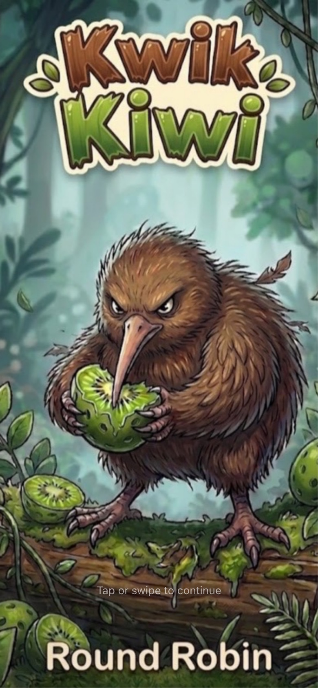
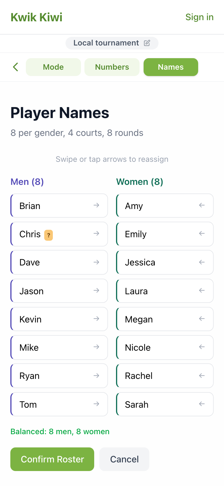
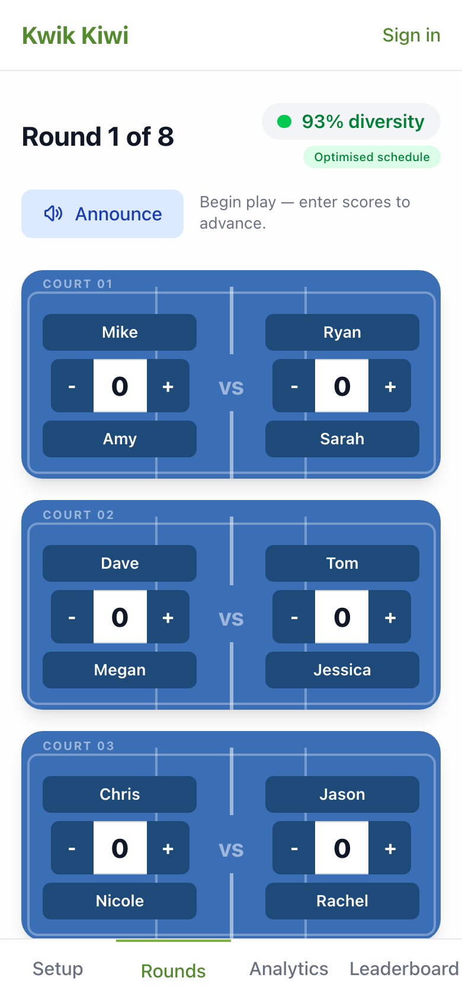
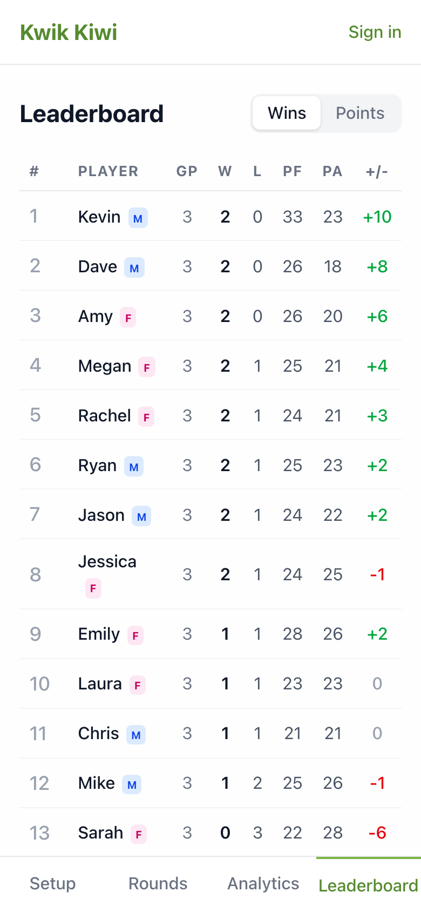
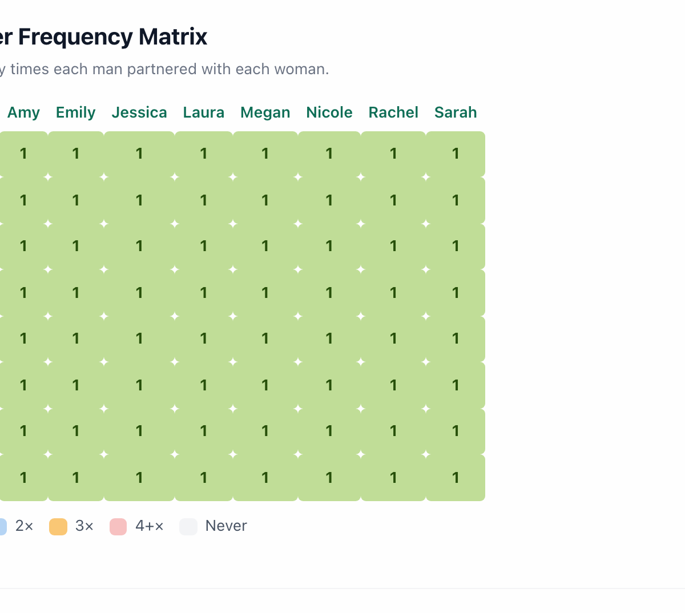
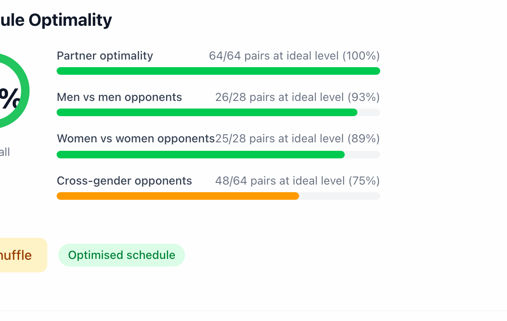
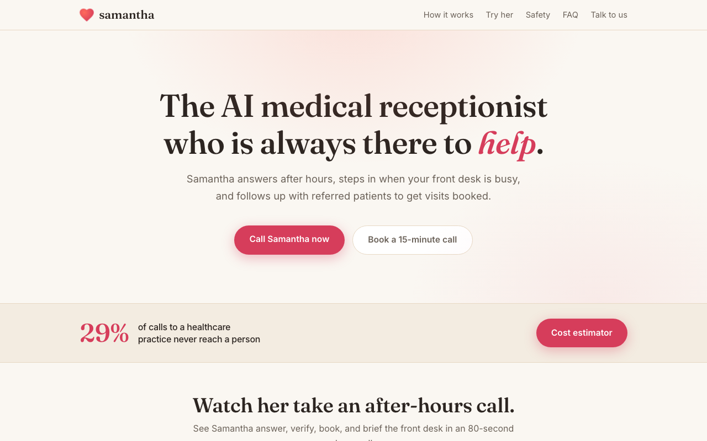

## Hi, I'm Jeff Yingling

Hardware engineer working at the integration layer between AI and physical systems. 15+ years taking hardware from concept to production (PCB, FPGA, firmware, and the integration work between them), and lately building AI systems with Claude Code: agents, MCP servers, and full applications.

Based in Bellingham, WA · [LinkedIn](https://www.linkedin.com/in/jeffrey-yingling-78bab02a)

Most of my code lives in private repos. Source is available on request.

---

### Kwik Kiwi - pickleball round-robin scheduler

**[Try it live](https://quick-kiwi-round-robin.vercel.app)**

  
  
  
  

Builds round-robin schedules that maximize partner and opponent variety. For mixed doubles with prime-power player counts, a Galois field construction guarantees every man partners with every woman exactly once. For other counts and open doubles, simulated annealing searches partnerships and court groupings together.

*8 men, 8 women, 8 rounds: every man partners every woman exactly once.*

*Every schedule is scored on partner and opponent variety, and the app shows exactly where it falls short.*

- Runs a local game offline, or a public tournament that players join from their phones by code or QR
- Live scoring, court announcements with text-to-speech, analytics, and a leaderboard
- React 19, TypeScript, Vite, Zustand, Supabase, Vercel
- About 290 unit and component tests plus Playwright end-to-end tests, with CI on every pull request

### Samantha - AI medical receptionist

**[See the demo](https://samantha-medical.com/)**

A voice agent for medical practices that answers after hours, steps in when the front desk is busy, and follows up with referred patients to get visits booked. I built it as a solo founder: a HIPAA-compliant voice pipeline with telephony, custom tool calls, and validation. Built with Gemini LLMs, Azure telephony, and Python, developed with Claude Code.

### Job Huntress - AI job search agent

A local-first job search agent. It discovers listings directly from company ATS feeds (Greenhouse, Lever, Ashby, Workable), filters them with free code-side rules, then scores fit against my resume and preferences with an LLM. It tailors application materials and drives guided applications in my own browser with Playwright. It never submits anything without my click.

- Per-task model routing: Claude through a Claude Code subscription, Gemini, or local Ollama
- Python, FastAPI, React, SQLite, Playwright; 100+ tests

### Experiments

- **Imagine Idea Gen** - a multi-agent pipeline that generates marketing ideas from a seed idea, with a Creative Director agent judging each one against the business owner's taste. A prototype built around a founder's request (TypeScript monorepo, Postgres, job queue).

---

**How I build:** Claude Code on feature branches with Git and GitHub, tests alongside the code, and end-to-end checks before I call something done.
